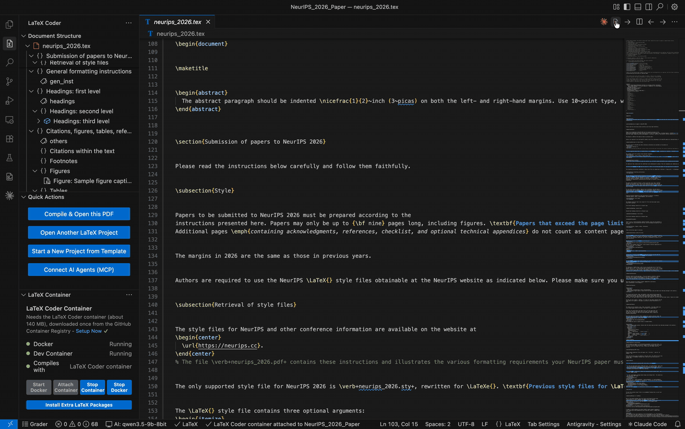

# LaTeX Coder Dev Container

**Get the extension:** [LaTeX Coder](https://marketplace.visualstudio.com/items?itemName=hasitha-gallella.latex-coder) on the VS Code Marketplace, or on [Open VSX](https://open-vsx.org/extension/hasitha-gallella/latex-coder) for Cursor, Antigravity and VSCodium.



TeX Live for pdfLaTeX and BibTeX on Debian slim, built for the LaTeX Coder VS Code extension. It
compiles conference papers, CVs and proposals with nothing to install on your machine but Docker.
The extension sets it up for you with **Setup Now**.

```
ghcr.io/hasithagallella/latex-coder:basic
```

For Apple Silicon (`linux/arm64`) and Intel (`linux/amd64`); about 140 MB to download.

## What's inside

- Debian `trixie-slim`, the official minimal image.
- TeX Live, installed from CTAN with TeX Live's own installer: pdfLaTeX, BibTeX, `latexmk` and
  SyncTeX, plus the LaTeX packages in [`packages.txt`](packages.txt). No XeLaTeX or LuaLaTeX.
- Perl, for `latexmk` and `tlmgr`, and `curl`, CA certificates and `gpg`, so `tlmgr` can download
  more packages and check their signatures. In the extension, **Install Extra LaTeX Packages** opens a
  terminal for that (`tlmgr install <package>`); the containers that compile have no network.
- A `vscode` user (UID 1000), with `/workspace` as the working folder. The extension mounts your
  paper's folder there, and its build folder (`.aux`, `.log`, the PDF) at `/build`, so build files
  stay out of your paper's folder.

It is built from scratch on Debian, not from another LaTeX image.

## AI agents

LaTeX Coder's MCP tools let AI agents compile and check papers in this container: see [agent-tools](agent-tools/README.md).

## Use it as a dev container

`.devcontainer/devcontainer.json` in your project:

```jsonc
{
  "name": "LaTeX Coder",
  "image": "ghcr.io/hasithagallella/latex-coder:basic",
  // The image has no git; this adds Debian's git when the container is created.
  "features": {
    "ghcr.io/devcontainers/features/git:1": { "version": "os-provided" }
  }
}
```

Then run **Dev Containers: Reopen in Container** in VS Code.

## Compile without VS Code

```
docker run --rm --network none -v "$PWD":/workspace ghcr.io/hasithagallella/latex-coder:basic \
  latexmk -pdf main.tex
```

## Build it yourself

```
docker build -t latex-coder:basic .
```

## Grammar check engine

The engine of the extension's offline grammar check, `latex_grammar_checker`, is a
[release of this repository](https://github.com/HasithaGallella/latex-coder-devcontainer/releases):
Harper's WebAssembly (Automattic, Apache License 2.0), unchanged and compressed, with Harper's
licence. The extension downloads it once and uses it only if its SHA-256 matches the one built
into the extension. It is not part of the image.

## Licence

The files in this repository are under the [MIT License](LICENSE). The image also contains Debian
and TeX Live, which keep their own licences; TeX Live's are in `/usr/local/texlive` inside the
image, and this repository's MIT licence is at `/usr/share/doc/latex-coder/LICENSE`.
