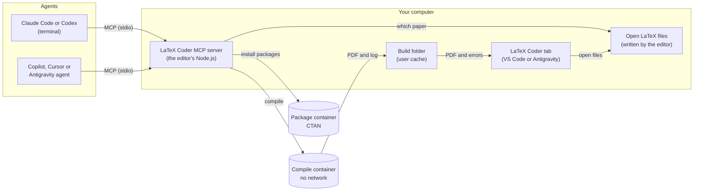

# LaTeX Coder agent tools (MCP)

The [LaTeX Coder](https://marketplace.visualstudio.com/items?itemName=hasitha-gallella.latex-coder) extension includes an MCP server, so AI coding agents can compile and check LaTeX projects. It runs on your computer and compiles in the [LaTeX Coder container](../README.md), or with a local TeX installation.

## How it works

The agent starts the server and calls its tools over MCP. The server finds the paper from the agent's working folder or the files open in the editor, compiles it in the container, and returns the errors. The editor's LaTeX Coder tab shows the new PDF and errors.

## Connect an agent

Run **Connect AI Agents (MCP)** from the Command Palette or from LaTeX Coder's Quick Actions. LaTeX Coder asks before it changes an agent's settings, and the same command disconnects it.

Supported agents: Claude Code, Codex, GitHub Copilot (agent mode), Cursor and Antigravity.

## Tools

| Tool | What it does |
| --- | --- |
| `compile_latex` | Compiles the project with latexmk. Returns the errors and warnings as `file:line: message`. |
| `get_latex_errors` | Reads the errors and warnings of the last compile, without compiling again. |
| `check_latex` | Checks LaTeX syntax and English grammar offline, without compiling. |
| `locate_latex_elements` | Finds sections, figures, tables and equations by number ("Table 1"), label or caption, with their file, lines and PDF page. |
| `find_latex_package` | Finds the TeX Live package that provides a file such as `tikz-cd.sty`, using CTAN's index. |
| `install_latex_packages` | Installs TeX Live packages into the container with `tlmgr`. |
| `latex_status` | Reports where LaTeX Coder compiles, the container's state, the extra packages installed and the LaTeX files open in the editor. |

When a tool is called without a `file`, it uses the main file in the agent's working folder or, failing that, the paper open in the editor.

## Example

> Check my paper, fix the errors and compile it.

The agent runs `check_latex` and `compile_latex`, edits the files, and compiles again until no errors are left.

## Limits

- Compiles run with shell escape and `latexmkrc` files turned off. In the container they have no network access.
- The tools read only files inside the project folder and do not follow symbolic links out of it. Build files go to LaTeX Coder's cache folder, not the project.
- An agent can compile with LuaLaTeX only if you set `latexCoder.compile.engine` to `lualatex`.
- Packages are downloaded by a separate container that has no access to your project files.
